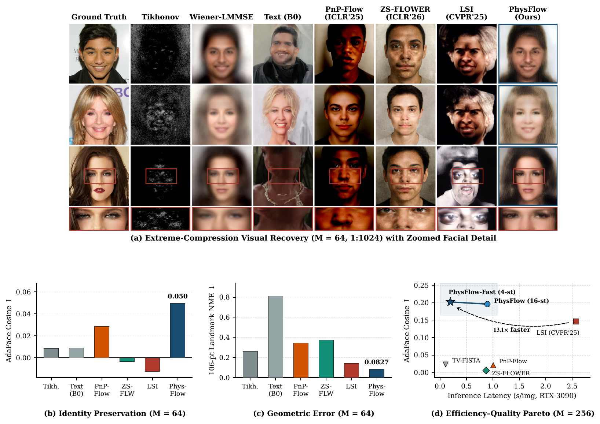
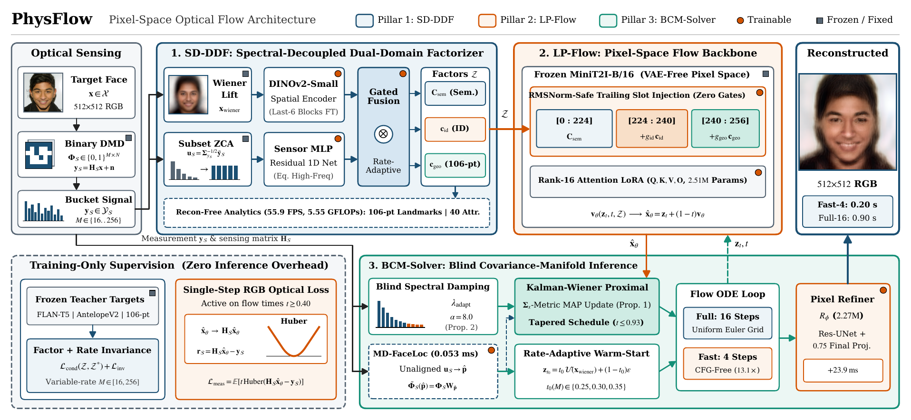

# PhysFlow-SPI

**PhysFlow: Factorized Physics-Aware Pixel-Space Flow Matching for Extreme-Compression Single-Pixel Face Reconstruction**

[](LICENSE)
[](https://www.python.org/)
[](https://pytorch.org/)

[English](#english) | [中文说明](#中文说明)

---

<p align="center">
  
</p>

## English

### Overview

**PhysFlow** is an open-source PyTorch research codebase for variable-rate single-pixel face reconstruction and reconstruction-free facial analysis under extreme sub-Nyquist binary sampling ($M \in \{16, 32, 64, 128, 256\}$ binary digital micromirror device [DMD] patterns over a $256 \times 256$ aperture, spanning $0.02\%$–$0.39\%$ sampling rates, down to $1{:}1024$ compression at $M = 64$).

Rather than hiding optical linearity behind a fixed-rate nonlinear latent decoder or fighting non-negative binary masks with speckle-prone Euclidean adjoints, PhysFlow preserves **exact pixel-space optical linearity end-to-end** through three tightly coupled pillars:

<p align="center">
  
</p>

1. **SD-DDF (Spectral-Decoupled Dual-Domain Factorizer)**: Pairs zero-parameter Wiener-LMMSE spatial lifting ($\mathbf{x}_{\mathrm{wiener}}$) with subset-adaptive ZCA whitening ($\mathbf{u}_{\mathcal{S}}$) to resolve the $\kappa(\mathbf{\Sigma}_y) \approx 2.38 \times 10^8$ spectral ill-conditioning of non-negative binary DMD masks. A single variable-rate DINOv2-Small encoder extracts continuous semantic tokens ($\mathbf{C}_{\mathrm{sem}}$), identity ($\mathbf{c}_{\mathrm{id}}$), and 106-point canonical geometry ($\mathbf{c}_{\mathrm{geo}}$) while directly enabling `55.9 FPS` reconstruction-free facial analytics.
2. **LP-Flow (Linear-Coupled Pixel-Space Flow Backbone)**: Adapts a frozen VAE-free pixel-space flow transformer (`MiniT2I-B/16`) via RMSNorm-safe zero-initialized trailing-slot residuals (`[224:240]` for $\mathbf{c}_{\mathrm{id}}$, `[240:256]` for $\mathbf{c}_{\mathrm{geo}}$) and rank-16 $\mathbf{Q}/\mathbf{K}/\mathbf{V}/\mathbf{O}$ attention LoRA (`2.51M` params), enabling direct single-step RGB optical supervision ($t \ge 0.40$), a decoupled $2.27\text{M}$ post-flow pixel refiner $R_{\phi}$ (`+23.9 ms`), and an optional 4-step CFG-free distilled mode (`PhysFlow-Fast`, `5.09 FPS` batched, `13.1x` faster than LSI).
3. **BCM-Solver (Blind Covariance-Manifold Proximal and Pullback Solver)**: Replaces Euclidean back-projection with a closed-form $\mathbf{\Sigma}_x$-metric Kalman-Wiener proximal step (Mahalanobis MAP optimality, Proposition 1) governed by an unbiased trailing-quarter noise variance estimator (Laurent–Massart concentration bound, Proposition 2). Exploiting linear warp duality ($\tilde{\mathbf{\Phi}}_{\mathcal{S}}(\hat{\mathbf{p}}) = \mathbf{\Phi}_{\mathcal{S}}\mathbf{W}_{\hat{\mathbf{p}}}$), a lightweight `1.32M` measurement-domain localizer (`MD-FaceLoc`, `0.053 ms`) extends the frozen prior to arbitrary unaligned apertures with zero extra training images and zero generator retraining.

<p align="center">
  
</p>

> We share this codebase humbly for reproducible research and community discussion. Suggestions, critiques, issue reports, and pull requests are warmly welcome!

---

### Research Journey & Practical Pitfalls We Encountered

A large part of what made PhysFlow work came from diagnosing dead ends rather than blindly scaling compute. We document our main empirical lessons here in case they help fellow researchers working on computational imaging or flow-matching inverse problems:

1. **Pitfall 1 — Naive 1D SPI encoders stall near the mean face**: Non-negative binary `{0,1}` DMD patterns couple every scalar measurement to a large DC floor, producing an empirical covariance condition number of $\kappa(\mathbf{\Sigma}_y) \approx 2.38 \times 10^8$ (top two eigenvalues `238.5` and `15.8` vs. trailing modes `~1e-3`). Feeding raw 1D measurements into an MLP barely moved past the population mean (`NME@64 = 0.0971` vs. `0.0975`). Equalizing the spectrum via closed-form ZCA whitening + Wiener spatial lifting cut landmark error by `35.2%` immediately with zero extra trainable parameters.
2. **Pitfall 2 — Bigger vision-language backbones do not automatically win on smooth Wiener lifts**: We tested replacing `DINOv2-Small` (`32.1M`) with the `3.3x` larger 2025 `SigLIP2-Base` (`106.7M`) under the exact same Stage 1A protocol. Somewhat surprisingly, `DINOv2-Small` outperformed `SigLIP2-Base` in identity (`+23.4%` at $M=64$, `+18.9%` at $M=256$), landmark accuracy (`0.0568` vs. `0.0580`), and 69-ID 5-fold CV Macro-F1 (`+14.2%`) while running `22.3%` faster—suggesting that dense self-supervised geometric pretraining reads smooth Wiener-lifted structures more effectively than caption-aligned encoders.
3. **Pitfall 3 — Inserting VGG perceptual loss inside mid-trajectory flow training breaks straight ODE paths**: Our first attempt to close the $M=256$ LPIPS sharpness gap added VGG-16 perceptual supervision at mid-flow timesteps ($t \ge 0.45$). It severely distorted rectified velocity fields and actually *worsened* validation LPIPS (`0.5349 -> 0.6739`). Decoupling high-frequency synthesis strictly to the flow endpoint ($t = 1$) via a zero-initialized `2.27M` residual U-Net refiner followed by a final physical projection (`0.75` weight) solved the problem cleanly (`M=256` LPIPS `0.5245 < 0.5340` StyleGAN-XL LSI, `p = 0.00025`, `RelRes = 0.0038`) in just `8.55 min`.
4. **Pitfall 4 — Classical spectral GCV under-regularizes under $\kappa \approx 2.38 \times 10^8$**: Under extreme binary DMD ill-conditioning, Generalized Cross-Validation aggregates a full-spectrum trace denominator and selects near-zero damping on noisy captures (`9.86 dB` under combined drift N4). Reading excess variance strictly from the trailing-quarter eigenmodes (Proposition 2, calibrated slope $\alpha = 8.0$) raised 6-axis average PSNR to `14.76 dB` (`+1.39 dB` over GCV, `+3.79 dB` on N4) and maintained `100%` face detectability under compound 5-effect optical benchtop distortions.
5. **Pitfall 5 — Matrix-transpose ordering in operator pullback**: Pulling a border-clamped bilinear warp $\mathbf{x}_{\mathrm{scene}} = \mathbf{W}_{\mathbf{p}}\mathbf{x}_{\mathrm{canon}}$ back through $\mathbf{\Phi}_{\mathcal{S}}$ gives $\tilde{\mathbf{\Phi}}_{\mathcal{S}}(\mathbf{p}) = \mathbf{\Phi}_{\mathcal{S}}\mathbf{W}_{\mathbf{p}}$, whose rows are computed in `< 1 ms` via the transpose VJP $\mathbf{W}_{\mathbf{p}}^{\top}\mathbf{\Phi}_{\mathcal{S}}^{\top}$ (verified to `9.74e-7` relative error against dense explicit multiplication).

---

### Summary of Main Results (Single NVIDIA RTX 3090 24 GB)

- **Training Footprint**: `1.39` GPU-hours core training (`83.29 min`, `2.80 GB` peak VRAM with BF16 + block activation checkpointing), `+8.55 min` (`2.27M` refiner), `+15.28 min` (optional 4-step Fast distillation) = **`1.79` GPU-hours** (`1.84` GPU-hours with optional `1.32M` `MD-FaceLoc` trained in `3.45 min`).
- **Full-Cohort CelebA-HQ (`N = 479` Strictly Identity-Disjoint Portraits)**:

| Method | $M=64$ FID $\downarrow$ | $M=64$ AdaFace $\uparrow$ | $M=64$ NME106 $\downarrow$ | $M=64$ LPIPS $\downarrow$ | $M=64$ PSNR $\uparrow$ | $M=256$ FID $\downarrow$ | $M=256$ AdaFace $\uparrow$ | $M=256$ LPIPS $\downarrow$ | $M=256$ PSNR $\uparrow$ | $M=256$ RelRes $\downarrow$ |
| :--- | :---: | :---: | :---: | :---: | :---: | :---: | :---: | :---: | :---: | :---: |
| TV-FISTA | 373.91 | 0.0137 | ---* | 0.8561 | 13.74 | 349.62 | 0.0236 | 0.8471 | 14.08 | 0.0100 |
| Wiener-LMMSE | 200.17 | 0.0295 | 0.0869 | 0.7276 | 17.30 | 175.28 | 0.1485 | 0.6921 | 19.46 | **0.0034** |
| PnP-Flow (ICLR 2025) | 146.94 | 0.0051 | 0.4090 | 0.6899 | 12.60 | 147.65 | 0.0212 | 0.6475 | 15.86 | 0.0101 |
| ZS-FLOWER (ICLR 2026) | 149.67 | 0.0037 | 0.4121 | 0.6606 | 11.75 | 181.94 | 0.0060 | 0.6623 | 14.02 | 0.0101 |
| LSI (CVPR 2025) | 167.03 | -0.0067 | 0.1365 | 0.7253 | 7.70 | 119.29 | 0.1462 | 0.5340 | 16.74 | 0.0382 |
| **PhysFlow-Fast (4-step)** | 132.09 | **0.0429** | **0.0728** | 0.5984 | **17.87** | 124.91 | **0.2022** | 0.5558 | **20.16** | 0.0045 |
| **PhysFlow (16-step)** | **114.31** | 0.0386 | 0.0750 | **0.5501** | 17.76 | **113.90** | 0.1961 | **0.5245** | 20.06 | 0.0038 |

*\*TV-FISTA yields 0/479 face detections.*
- **Real European Laboratory DMD Hardware (CREATIS SPIHIM & 2026 ONE-PIX RGB, Zero Generator Retraining)**: `PhysFlow-ZS` ranks `#1` across differential rates (`15.67 / 18.06 / 21.17 dB`) and single-exposure unipolar `{0,1}` capture (`17.86 dB` vs. `10.44 dB` PnP-Flow and `13.16 dB` TV-FISTA).
- **Unaligned Arbitrary-FOV Recovery ($M=256$, Zero Extra Training Images)**: `PhysFlow + MD-FaceLoc` (`0.053 ms`) achieves **`19.92 dB` PSNR** (`+3.97 dB` vs. LSI) and **`0.1214` Buffalo\_L** (`3.72x` LSI, `89.8%` of oracle pose).

---

### Installation & Quick Start

```bash
# 1. Clone the repository
git clone https://github.com/WYH302/PhysFlow-SPI.git
cd PhysFlow-SPI

# 2. Create a clean Python 3.12 environment
python -m venv .venv
source .venv/bin/activate  # Windows PowerShell: .\.venv\Scripts\Activate.ps1

# 3. Install PyTorch matching your CUDA version, then project dependencies
pip install torch torchvision --index-url https://download.pytorch.org/whl/cu124
pip install -r requirements.txt

# 4. Run unit tests and module smoke checks
pytest -q
python scripts/check_gpu.py
python scripts/smoke_modules.py
```

Place public datasets (`FFHQ`, `CelebA`, `CelebA-HQ`, `LaPa`, `WFLW`) under `data/raw/`, official LSI optical mask/baseline assets under `third_party/latent-imaging/paper_checkpoints/`, and pretrained weights (`MiniT2I-B/16`, `FLAN-T5-Large`, `DINOv2-Small`, `InsightFace`, `AdaFace`) under `checkpoints/` (all excluded from version control via `.gitignore`).

### Reproducing Experiments & Figures

```bash
# Data preparation & forward operator check
python scripts/build_real_dataset_cache.py
python scripts/assert_phi_official.py

# Core three-stage training (1.39 GPU-h) & primary benchmarks
python scripts/run_phase1a_real.py
python scripts/run_phase1b_oracle_real.py
python scripts/run_phase2_e2e_physflow.py
python scripts/run_phase3_downstream_and_paper.py
python scripts/eval_lapa_wflw.py
python scripts/run_journal_audit_extras.py
python scripts/run_reviewer_shield_suite.py
python scripts/finish_module_e_full479.py

# Calibration, benchtop twin, SigLIP2 ablation, pixel refiner & 4-step Fast mode
python scripts/run_v3_step1_inference_upgrade.py
python scripts/run_v3_step2_benchtop_twin.py
python scripts/run_v3_step3_siglip2.py
python scripts/run_v3_step4_pixel_refiner.py
python scripts/run_v3_step5_fast4step.py
python scripts/run_v3_step6_final_full479.py
python scripts/run_v3_step6b_quick_checks.py

# Literature protocol anchor, real CREATIS/ONE-PIX DMD hardware & unaligned FOV
python scripts/run_v4_knife1_lsi_protocol.py
python scripts/run_v4_knife2_real_dmd_hardware.py
python scripts/run_v4_knife3_unaligned_fov.py
python scripts/run_v4_knife4_refiner_tv_and_figs.py

# Regenerate all IEEE publication vector figures (Figs. 1–8)
python scripts/generate_fig2_architecture.py
python scripts/generate_journal_figures.py
python scripts/generate_fig7_shield.py
```

### Citation

```bibtex
@article{wu2026physflow,
  author  = {Wu, Yonghao},
  title   = {PhysFlow: Factorized Physics-Aware Pixel-Space Flow Matching for Extreme-Compression Single-Pixel Face Reconstruction},
  journal = {IEEE Transactions (Preprint)},
  year    = {2026},
  note    = {Manuscript under review}
}
```

### Acknowledgements

We sincerely thank the authors and open-source communities behind MiniT2I, Latent Space Imaging (LSI), FLOWER, PnP-Flow, OpenSpyrit/CREATIS, DINOv2, SigLIP 2, InsightFace, and AdaFace for releasing public benchmarks, optical matrices, and pretrained models.

---

## 中文说明

### 项目简介

**PhysFlow** 是面向极端亚奈奎斯特二值采样（$256 \times 256$ 光学口径下仅采集 $M \in \{16, 32, 64, 128, 256\}$ 组二值 DMD 掩膜测量，对应 $0.02\%$–$0.39\%$ 采样率，在 $M = 64$ 达到 $1{:}1024$ 压缩比）的单像素人脸重建与免重建视觉分析开源 PyTorch 实现。

与传统将光学测量塞入固定采样率非线性潜空间解码器、或在推理端用欧氏伴随矩阵硬投影导致棋盘散斑的做法不同，PhysFlow 在无 VAE 像素空间流匹配框架中**端到端保留单像素成像的精确线性几何**，由三大紧密耦合的模块构成：

1. **SD-DDF（谱解耦双域分解器）**：并行结合零参数闭式 Wiener-LMMSE 空间提升（$\mathbf{x}_{\mathrm{wiener}}$）与子集自适应 ZCA 白化（$\mathbf{u}_{\mathcal{S}}$），破解非负二值 DMD 掩膜导致的 $\kappa(\mathbf{\Sigma}_y) \approx 2.38 \times 10^8$ 极端谱病态；单一可变采样率 `DINOv2-Small` 编码器输出语义矩阵 $\mathbf{C}_{\mathrm{sem}}$、身份向量 $\mathbf{c}_{\mathrm{id}}$ 与 106 点几何向量 $\mathbf{c}_{\mathrm{geo}}$，并直接支持 `55.9 FPS` 免重建属性与关键点分析。
2. **LP-Flow（线性耦合像素空间流主干）**：通过 RMSNorm 安全的零初始化尾槽残差（`[224:240]` 与 `[240:256]`）和秩-16 注意力 LoRA（`2.51M` 参数）微调冻结的 `MiniT2I-B/16` 像素流主干，实现单步 RGB 光学一致性监督、流末端解耦像素高频精修（`2.27M` 参数，仅增 `23.9 ms`）及可选 4 步无 CFG 实时模式（`PhysFlow-Fast`，批处理 `5.09 FPS`，较 LSI 提速 `13.1 倍`）。
3. **BCM-Solver（盲协方差流形近端与算子拉回求解器）**：以先验协方差 $\mathbf{\Sigma}_x$ 度量下的严格 MAP 近端更新（Proposition 1）替代欧氏投影，配合无偏尾谱噪声方差估计器（Laurent–Massart 集中界，Proposition 2）实现未知漂移下的盲自适应阻尼；针对任意非对齐视场，利用线性形变对偶性（$\tilde{\mathbf{\Phi}}_{\mathcal{S}}(\hat{\mathbf{p}}) = \mathbf{\Phi}_{\mathcal{S}}\mathbf{W}_{\hat{\mathbf{p}}}$）配合 `0.053 ms` 测量域定位器 `MD-FaceLoc`，在零新增训练图像、零重训生成器的前提下直接完成高精度非对齐恢复。

---

### 真实的思考过程与踩坑复盘

本项目最终能跑通并取得稳定提升，很大程度上源于我们在实验过程中踩过几个非常真实的坑、并把背后的物理机理刨根问底搞清楚了：

1. **踩坑一：为什么裸 1D 测量直接进神经网络几乎学不出人脸？**
   一开始我们直接用多层感知机或 Transformer 读原始 1D 测量向量 $\mathbf{y}_{\mathcal{S}}$，结果 106 点关键点误差（`0.0971`）和直接输出“平均脸”（`0.0975`）几乎没区别。对训练观测做谱分解后才恍然大悟：物理二值 `{0,1}` 掩膜天然非负，导致前两个直流/低频特征值（`238.5` 和 `15.8`）比尾部高出五个数量级（条件数 $\kappa \approx 2.38 \times 10^8$）。引入零参数 ZCA 白化 + Wiener 空间提升后，关键点误差当场下降 `35.2%`。
2. **踩坑二：视觉编码器并非参数越大越好**
   为了检验特征底座上限，我们在完全一致的 Stage 1A 协议下把 `32.1M` 的 `DINOv2-Small` 换成体积大 `3.3 倍` 的 2025 视觉语言底座 `SigLIP2-Base`（`106.7M`）。实测结果颇出意料：`DINOv2-Small` 在身份相似度（`+23.4%` @64 / `+18.9%` @256）、关键点误差（`0.0568` vs. `0.0580`）和 69 人五折交叉验证 Macro-F1（`+14.2%`）上全面胜出，且速度快 `22.3%`。原因在于面向稠密空间几何自监督的 DINOv2 比面向图文对齐的编码器更擅长从平滑 Wiener 提升图中抓出精细五官结构。
3. **踩坑三：把 VGG 感知损失直接塞进流匹配中间步会毁掉轨迹直度**
   早期在 $M=256$ 上我们的 LPIPS 略逊于 StyleGAN-XL 底座的 LSI。我们尝试过在流训练中间步（$t \ge 0.45$）直接加 VGG-16 感知损失，结果反而拉弯了速度场，验证集 LPIPS 从 `0.5349` 恶化到 `0.6739`。后来彻底改为**将高频纹理精修严格解耦到流终点 $t = 1$**（`2.27M` 零初始化残差 U-Net + `0.75` 末步物理投影），仅训练 `8.55 分钟` 就把 $M=256$ LPIPS 压到 `0.5245`（显著优于 LSI 的 `0.5340`，$p = 0.00025$），同时把物理残差锁死在 `0.38%`。
4. **踩坑四：极端病态二值掩膜下，经典谱 GCV 会系统性欠正则**
   我们最初对比了经典的广义交叉验证（GCV）来自动选阻尼系数 $\lambda$，但在 $\kappa \approx 2.38 \times 10^8$ 的二值掩膜下，GCV 的全谱迹分母在噪声场景严重欠正则（复合漂移 N4 跌至 `9.86 dB`）。改为只从尾部四分之一近零信号模态读取超额噪声方差（Proposition 2，标定斜率 $\alpha = 8.0$）后，六类未知噪声平均 PSNR 提升至 `14.76 dB`（领先 GCV `+1.39 dB`，N4 领先 `+3.79 dB`）。
5. **踩坑五：真实实验室单极性 `{0,1}` 采样与非对齐算子拉回**
   在法国 CREATIS 实验室真实 DMD 数据的单次曝光单极性 `{0,1}` 采集下，由于存在强秩-1 直流分量，TV-FISTA（`13.16 dB`）与 PnP-Flow（`10.44 dB`）几乎崩溃，而零重训 `PhysFlow-ZS` 稳居 `17.86 dB`。同样，利用像素空间线性对偶直接拉回非对齐算子，让我们在不增补任何一张训练人脸的情况下将任意视场 $M=256$ 恢复做到 `19.92 dB`（达 Oracle 位姿上界 `89.8%` 的身份保真度）。

---

### 诚恳致谢与交流欢迎

本仓库旨在分享我们在极端压缩单像素成像上的一些探索与完整可复现代码。作者水平有限，文档与实现中难免存在疏漏或可进一步优化之处，**非常欢迎各位老师与同行通过 Issue、PR 或邮件（`yonghaowu369@gmail.com`）批评指正与交流探讨！**

本项目基于 [MIT License](LICENSE) 开源。
