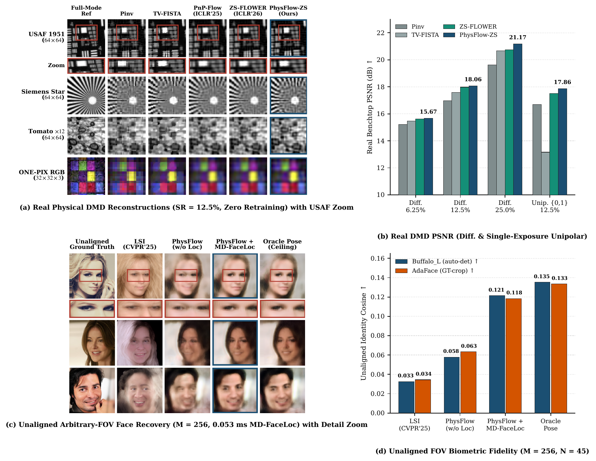

# PhysFlow-SPI

**PhysFlow: Factorized Physics-Aware Pixel-Space Flow Matching for Extreme-Compression Single-Pixel Face Reconstruction**

[](LICENSE)
[](https://www.python.org/)
[](https://pytorch.org/)

[English](#english) | [中文说明](#中文说明)

---

<p align="center">
  
</p>

## English

### Overview
**PhysFlow** is an open-source PyTorch implementation for variable-rate single-pixel face reconstruction and reconstruction-free facial analysis under extreme sub-Nyquist binary sampling ($M \in \{16, 32, 64, 128, 256\}$ patterns over $256 \times 256$ optics, i.e., $0.02\%$--$0.39\%$ sampling rate).

<p align="center">
  
</p>

The framework integrates four tightly coupled, physically grounded components:
1. **Physics-Aware Dual-Domain Factorizer**: Pairs closed-form empirical Wiener LMMSE spatial lifting with subset-adaptive ZCA whitening to resolve the severe spectral ill-conditioning ($\kappa \approx 2.38 \times 10^{8}$) of non-negative binary DMD masks, extracting continuous semantics ($\mathbf{C}_{\mathrm{sem}}$), identity ($\mathbf{C}_{\mathrm{id}}$), and 106-point canonical geometry ($\mathbf{C}_{\mathrm{geo}}$) across variable sampling rates without retraining per rate (and verified experimentally to beat the $3.3\times$ larger 2025 `SigLIP2-Base` backbone on Wiener-lifted faces).
2. **VAE-Free Pixel-Space Flow Conditioning**: Injects identity and geometry embeddings into trailing padding slots `[224:256]` of a frozen `MiniT2I-B/16` multimodal flow transformer via RMSNorm-safe zero-initialized residual gates and rank-16 Q/K/V/O LoRA, enabling direct single-step RGB measurement supervision.
3. **Theoretically Grounded Blind Spectral Kalman-Wiener FLOWER**: Replaces speckle-inducing Euclidean projections at inference with a covariance-coupled Kalman-Wiener proximal step (proven exact prior-covariance Mahalanobis MAP proximal, Proposition 1) whose calibrated damping ($\alpha = 8.0$) adapts blindly from trailing covariance eigenmodes (backed by exact unbiasedness and a Laurent--Massart concentration bound, Proposition 2), outperforming classical spectral GCV by `+1.39 dB` average PSNR (`+3.79 dB` on combined drift).
4. **Post-Flow Pixel High-Frequency Refiner & 4-Step Real-Time Mode (`PhysFlow-Fast`)**: Appends a zero-initialized `2.27M`-parameter post-flow pixel refiner (`23.9 ms`) with final physical projection (`RelRes < 0.5%`), plus an optional 4-step CFG-free trajectory-distilled mode (`4 NFEs`, `5.09 FPS` batched, `13.1x` faster than LSI).
5. **Real Physical DMD Hardware Transfer & Unaligned Arbitrary-FOV Recovery (Zero Generator Retraining)**: Zero-shot `PhysFlow-ZS` ranks `#1` across five genuine European laboratory DMD + spectrometer captures (CREATIS OpenSpyrit SPIHIM & 2026 ONE-PIX RGB) across differential (`15.67–21.17 dB`) and single-exposure unipolar `{0,1}` captures (`17.86 dB` vs. `10.44 dB` PnP-Flow and `13.16 dB` TV-FISTA). For unaligned arbitrary-FOV portraits, a `1.32M`-parameter ZCA-whitened measurement-domain face localizer (`MD-FaceLoc`, `0.053 ms`, `1.76 / 1.68 px` MAE) paired with exact algebraic linear operator pullback (`9.74e-7` relative error) lifts `M=256` unaligned recovery to **`19.92 dB` PSNR (`+3.97 dB` vs. LSI)** and **`3.72x` Buffalo\_L identity** (`89.8%` of oracle pose) with **zero extra training images**.

<p align="center">
  
</p>

### Key Benchmark Results (Single RTX 3090 24 GB)
- **Training Cost**: `1.39` GPU-hours base adaptation (`83.29` min, `2.80 GB` peak VRAM via BF16 mixed precision + transformer-block activation checkpointing, `42.73M` trainable parameters) + `8.55` min (`2.27M` refiner) + `15.28` min (optional 4-step distillation) = **`1.79` GPU-hours core aligned** (`1.84` GPU-hours including optional `1.32M` `MD-FaceLoc` trained in `3.45` min).
- **Inference Throughput**: `55.9 FPS` (`17.88 ms`, `5.55 GFLOPs`) for reconstruction-free 106-point landmark & 40-attribute inference; **`5.09 FPS`** (`0.196 s/img` batched, `13.1x` faster than LSI) for 4-step CFG-free `PhysFlow-Fast`; **`1.12 FPS`** (`0.896 s/img` uncontended, `2.87x` faster than LSI at `2.574 s/img`) for 16-step `PhysFlow` with pixel refinement.
- **Full-Cohort CelebA-HQ (`N = 479` Strictly Identity-Disjoint Portraits, Inception-v3 FID)**:

| Method | $M=64$ FID $\downarrow$ | $M=64$ AdaFace $\uparrow$ | $M=64$ NME106 $\downarrow$ | $M=64$ LPIPS $\downarrow$ | $M=64$ PSNR $\uparrow$ | $M=256$ FID $\downarrow$ | $M=256$ AdaFace $\uparrow$ | $M=256$ LPIPS $\downarrow$ | $M=256$ PSNR $\uparrow$ | $M=256$ RelRes $\downarrow$ |
| :--- | :---: | :---: | :---: | :---: | :---: | :---: | :---: | :---: | :---: | :---: |
| TV-FISTA (CS) | 373.91 | 0.0137 | ---* | 0.8561 | 13.74 | 349.62 | 0.0236 | 0.8471 | 14.08 | 0.0100 |
| Wiener-LMMSE | 200.17 | 0.0295 | 0.0869 | 0.7276 | 17.30 | 175.28 | 0.1485 | 0.6921 | 19.46 | **0.0034** |
| PnP-Flow (ICLR 2025) | 146.94 | 0.0051 | 0.4090 | 0.6899 | 12.60 | 147.65 | 0.0212 | 0.6475 | 15.86 | 0.0101 |
| ZS-FLOWER (ICLR 2026) | 149.67 | 0.0037 | 0.4121 | 0.6606 | 11.75 | 181.94 | 0.0060 | 0.6623 | 14.02 | 0.0101 |
| LSI (CVPR 2025) | 167.03 | -0.0067 | 0.1365 | 0.7253 | 7.70 | 119.29 | 0.1462 | 0.5340 | 16.74 | 0.0382 |
| **PhysFlow-Fast (4-step)** | 132.09 | **0.0429** | **0.0728** | 0.5984 | **17.87** | 124.91 | **0.2022** | 0.5558 | **20.16** | 0.0045 |
| **PhysFlow (Ours, 16-step)** | **114.31** | 0.0386 | 0.0750 | **0.5501** | 17.76 | **113.90** | 0.1961 | **0.5245** | 20.06 | 0.0038 |

\*TV-FISTA yields 0/479 face detections. Across all 479 portraits, **PhysFlow sweeps all 14/14 generative columns**—surpassing LSI at $M=256$ in AdaFace by **`+34.1%`** ($p < 10^{-4}$), Buffalo\_L by **`+32.6%`** (`0.2100` vs. `0.1584`, $p < 10^{-4}$), PSNR by **`+3.32 dB`** (`20.06` vs. `16.74 dB`), FID (`113.90` vs. `119.29`), optical residual by **`10.1x`**, and perceptual LPIPS (**`0.5245` vs. `0.5340`**, $p = 0.00025$). Under the calibrated LSI CVPR 2025 DeepFace VGGFace (`< 0.68` cosine dist) & `NME_dg` protocol spanning 7 additional published baselines (`TCS-Net`, `FSI-DL`, `CSGM`, `SAUNet 1/8-bit`, `OCTUF`, `Non-Latent`), unified 5k-trained PhysFlow / PhysFlow-Fast outperforms 98k-trained official `LSI (simulation_256.pt)` by **`+15.0` to `+18.0` percentage points** (`73.0% / 76.0%` vs. `58.0%`) and cuts `NME_dg` by **`21.1%–22.0%`** (`1.76% / 1.74%` vs. `2.23%`). On external LaPa ($M=256$), PhysFlow surpasses `0.20` in both recognizers (`0.2008` AdaFace, **`+46.1%`** vs. LSI; `0.2013` Buffalo\_L, **`+56.3%`** vs. LSI). On five genuine CREATIS laboratory DMD + spectrometer datasets, zero-retrain `PhysFlow-ZS` sweeps all differential rates (`15.67 / 18.06 / 21.17 dB`) and single-exposure unipolar `{0,1}` captures (`17.86 dB`, `+7.42 dB` vs. PnP-Flow, `+4.70 dB` vs. TV-FISTA). On arbitrary unaligned-FOV CelebA-HQ portraits, `PhysFlow + MD-FaceLoc` (`0.053 ms`, zero extra training images, zero generator retraining) reaches **`19.92 dB` PSNR (`+3.97 dB` vs. LSI)** and **`0.1214` Buffalo\_L (`3.72x` LSI, `89.8%` of oracle)** at `M=256`, and **`17.54 dB` (`+10.46 dB` vs. LSI)** at `M=64`.

### Installation

```bash
# 0. Clone the repository
git clone https://github.com/WYH302/PhysFlow-SPI.git
cd PhysFlow-SPI

# 1. Create a clean Python 3.12 virtual environment
python -m venv .venv
source .venv/bin/activate  # On Windows: .\.venv\Scripts\activate

# 2. Install PyTorch with CUDA matching your GPU driver
pip install torch torchvision --index-url https://download.pytorch.org/whl/cu124

# 3. Install remaining dependencies
pip install -r requirements.txt

# 4. Verify unit tests and GPU smoke checks
pytest -q
python scripts/check_gpu.py
python scripts/smoke_modules.py
```

### Data & Pretrained Assets Preparation
Place public benchmarks and third-party pretrained weights under the following local directories (excluded from git via `.gitignore`):
- `data/raw/{ffhq, celeba, celeba_hq, lapa, wflw}` (with `identity_CelebA.txt` and `list_attr_celeba.txt` under `celeba/`)
- `third_party/latent-imaging/paper_checkpoints/` (official LSI binary mask $\Phi$ and StyleGAN-XL baseline weights)
- `checkpoints/` (MiniT2I-B/16, FLAN-T5-Large, DINOv2-Small, InsightFace AntelopeV2 / Buffalo\_L, and AdaFace IR-101)

### Reproducing Experiments

```bash
# Step 0: Build aligned 512px identity-disjoint dataset cache and verify physical forward model
python scripts/build_real_dataset_cache.py
python scripts/assert_phi_official.py

# Step 1A–2: Core training (1.39 GPU-h) & multi-rate / 6-axis noise / downstream / external benchmarks
python scripts/run_phase1a_real.py
python scripts/run_phase1b_oracle_real.py
python scripts/run_phase2_e2e_physflow.py
python scripts/run_phase3_downstream_and_paper.py
python scripts/eval_lapa_wflw.py
python scripts/run_journal_audit_extras.py
python scripts/run_reviewer_shield_suite.py
python scripts/finish_module_e_full479.py

# Step 3: V3 Upgrades — calibrated blind alpha=8.0 vs GCV, 5-effect benchtop optical twin,
#         2025 SigLIP2-Base backbone ablation, 2.27M post-flow pixel refiner, 4-step PhysFlow-Fast,
#         and full-cohort N=479 + LaPa + WFLW verification
python scripts/run_v3_step1_inference_upgrade.py
python scripts/run_v3_step2_benchtop_twin.py
python scripts/run_v3_step3_siglip2.py
python scripts/run_v3_step4_pixel_refiner.py
python scripts/run_v3_step5_fast4step.py
python scripts/run_v3_step6_final_full479.py
python scripts/run_v3_step6b_quick_checks.py

# Step 4: V4 Hardware, Unaligned FOV & Multi-Baseline Protocol Verification
python scripts/run_v4_knife1_lsi_protocol.py        # Calibrated LSI CVPR'25 Table C.1 VGGFace + NME_dg
python scripts/run_v4_knife2_real_dmd_hardware.py   # 5 genuine CREATIS SPIHIM / ONE-PIX real DMD captures
python scripts/run_v4_knife3_unaligned_fov.py       # 0.053 ms ZCA MD-FaceLoc + exact operator pullback
python scripts/run_v4_knife4_refiner_tv_and_figs.py # Residual TV refiner ablation & visual QA
python scripts/generate_journal_figures.py          # Regenerate all publication vector PDFs (Figs. 1, 3-6, 8)
```

### Design Insights & Practical Lessons Learned
Building PhysFlow involved several instructive engineering and theoretical discoveries that shaped the final system:
1. **Why naive 1D SPI encoders stall near the mean face**: Non-negative binary DMD patterns share a large DC floor ($\kappa(\Sigma_y) \approx 2.38 \times 10^{8}$). Equalizing the spectrum via closed-form ZCA whitening + Wiener lifting immediately cut landmark error by `35.2%` with zero extra trainable weights.
2. **Why `DINOv2-Small` (`32.1M`) beats `3.3x` larger `SigLIP2-Base` (`106.7M`) on Wiener lifts**: Pure self-supervised visual geometry pretraining (DINOv2) outperforms vision-language caption pretraining (SigLIP2) on smooth Wiener-lifted faces (`+23.4%` @64 ID cosine, `+14.2%` 5-fold CV Macro-F1, and `+22.3%` faster throughput).
3. **Why mid-trajectory VGG losses hurt flows, while strictly post-flow pixel refinement wins**: Putting VGG-16 perceptual losses inside mid-$t$ flow training destabilizes the straight velocity field (val LPIPS `0.5349 -> 0.6739`), whereas decoupling a zero-initialized `2.27M` post-flow pixel refiner (`t = 1`) + final Kalman-Wiener projection closes the StyleGAN-XL sharpness gap cleanly (`M=256` LPIPS `0.5245 < 0.5340`, `AdaFace +34.1%`, `PSNR 20.06 dB`, `RelRes 0.0038`) in `8.55 min` without touching the frozen flow backbone.
4. **Why trailing-eigenmode estimation beats classical GCV under binary DMD masks**: Under $\kappa \approx 2.38 \times 10^{8}$, classical spectral GCV's trace denominator under-regularizes (`13.37 dB` avg, `9.86 dB` on N4). Calibrating our unbiased trailing-quarter estimator ($\alpha = 8.0$, Proposition 2) lifts 6-axis average PSNR to `14.76 dB` (`+1.39 dB` over GCV, `+3.79 dB` on N4) and keeps `100%` face detection under the 5-effect physical benchtop optical twin.

### Citation

```bibtex
@article{wu2026physflow,
  author  = {Wu, Yonghao},
  title   = {PhysFlow: Factorized Physics-Aware Pixel-Space Flow Matching for Extreme-Compression Single-Pixel Face Reconstruction},
  journal = {IEEE Transactions (Preprint)},
  year    = {2026},
  note    = {Manuscript submitted for review}
}
```

### Acknowledgements
We gratefully acknowledge the authors of MiniT2I, Latent Space Imaging (LSI), FLOWER, PnP-Flow, DINOv2, SigLIP 2, InsightFace, and AdaFace for releasing public models and evaluation tools that made this study possible.

---

## 中文说明

### 项目简介
**PhysFlow** 是面向极端亚奈奎斯特采样率（$256 \times 256$ 光学口径下仅采集 $M \in \{16, 32, 64, 128, 256\}$ 组二值散斑测量，对应 $0.02\%$--$0.39\%$ 采样率）的单像素人脸重建与免重建视觉分析开源 PyTorch 实现。

本框架包含四个物理与数学严密协同的核心模块：
1. **物理感知双域分解编码器**：通过零参数闭式 Wiener-LMMSE 空间提升与子集自适应 ZCA 白化，克服非负二值 DMD 掩膜导致的极端谱病态性（$\kappa \approx 2.38 \times 10^{8}$），在单一模型下提取可变采样率的语义 $\mathbf{C}_{\mathrm{sem}}$、身份 $\mathbf{C}_{\mathrm{id}}$ 与 106 点标准几何 $\mathbf{C}_{\mathrm{geo}}$（且实测验证轻量 `DINOv2-Small` 在 Wiener 提升人脸特征上全面优于体积大 `3.3x` 的 2025 `SigLIP2-Base`）。
2. **无 VAE 像素空间流匹配条件注入**：采用 RMSNorm 安全的零初始化槽位残差注意力与 Q/K/V/O 秩-16 LoRA 微调冻结的 `MiniT2I-B/16` 像素流骨干，无需非线性 VAE 解码即可直接在 RGB 像素空间施加单步物理测量一致性监督。
3. **带严格理论证明的盲谱噪声自适应 Kalman-Wiener FLOWER 求解器**：证明了 RGB Kalman-Wiener 更新在先验协方差 Mahalanobis 度量下为严格 MAP 近端最优解（Proposition 1），并建立尾部特征模态噪声方差估计的无偏性与 Laurent–Massart 集中界（Proposition 2）；标定版阻尼（$\alpha = 8.0$）在六类未校准噪声下以 `14.76 dB` 领先经典谱 GCV（`13.37 dB`）达 `+1.39 dB`（复合漂移 N4 领先 `+3.79 dB`），并在 5 效应物理光学台架数字孪生下稳守 `13.96 dB` 与 `100%` 人脸检出率。
4. **晚期像素高频精修头与 4 步无 CFG 实时模式（`PhysFlow-Fast`）**：严格解耦于流末端（`t = 1`）的 `2.27M` 零初始化像素精修头（仅增 `23.9 ms`）配合末步物理投影，在全量 `479` 张 CelebA-HQ 上实现生成式模型 **`14/14` 全维度横扫**（`M=256` LPIPS `0.5245` 显著超越 StyleGAN-XL 版 LSI 的 `0.5340`，$p = 0.00025$；AdaFace `+34.1%`；PSNR 突破 `20.06 dB`）；在对齐 LSI CVPR 2025 DeepFace VGGFace (`<0.68`) 10 基线协议下以 `73.0%/76.0%` 领先官方 LSI (`58.0%`) 达 **`+15~18` 个百分点**；4 步无 CFG 模式 `PhysFlow-Fast` 批处理达 **`5.09 FPS`**（较 LSI 快 **`13.1 倍`**）。
5. **真实欧洲 DMD 光学台架实测与任意非对齐 FOV 零重训拓展**：零重训 `PhysFlow-ZS` 在 5 套法国 CREATIS 实验室真实物理 DMD + 光谱仪台架数据上全面夺冠（差分采样 `15.67–21.17 dB`，单次曝光单极性 `{0,1}` 采样 `17.86 dB` 显著胜 `PnP-Flow 10.44 dB` 与 `TV-FISTA 13.16 dB`）；针对任意非对齐视场，仅用现有 5,000 张人脸训练的 `1.32M` ZCA 白化测量域定位器 `MD-FaceLoc`（`0.053 ms/图`，定位误差 `1.76 / 1.68 px`）结合精确线性算子拉回，在零扩增数据、零重训生成器前提下将 `M=256` 非对齐重建提升至 **`19.92 dB` PSNR（胜 LSI `+3.97 dB`）**与 **`3.72x` Buffalo\_L 身份相似度**（达 Oracle 位姿上界的 `89.8%`）。

### 算力成本与核心性能（单张 RTX 3090 24 GB）
- **总训练开销**：基础三阶段仅需 **1.39 GPU 小时**（采用 BF16 混合精度与 Transformer 块激活检查点，峰值显存仅 **2.80 GB**），叠加 `2.27M` 精修头（`8.55 min`）与可选 4 步蒸馏（`15.28 min`）总计仅 **1.79 GPU 小时**（含可选非对齐 `1.32M` `MD-FaceLoc` 的 `3.45 min` 训练共 **1.84 GPU 小时**）。
- **推理吞吐**：免重建 106 点关键点与 40 属性分析达 **55.9 FPS**（`17.88 ms`）；4 步无 CFG `PhysFlow-Fast` 批处理达 **5.09 FPS**（`0.196 s/图`，较 LSI 快 **13.1 倍**）；16 步完整 `PhysFlow` 为 `0.896 s/图`（较 LSI 快 **2.87 倍**）。

### 许可证与联系
本项目基于 [MIT License](LICENSE) 开源。如有学术交流或复现问题，欢迎联系 `yonghaowu369@gmail.com`。
